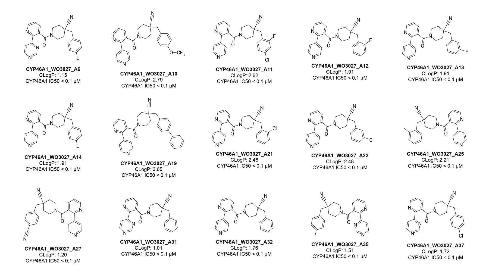
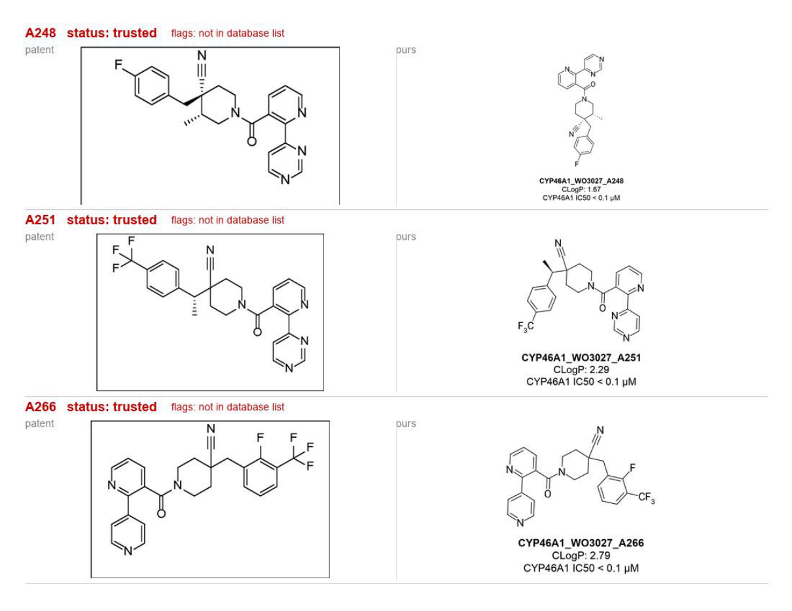

# Patent Drawer

A Claude skill that turns the compounds in a chemistry patent into:

- one **ChemDraw card** (`.cdxml`) per compound,
- a **PowerPoint** deck with each card embedded as a double-click-editable ChemDraw object (Windows),
- an **Excel** tracker with SMILES,
- a **validation report** and a contact sheet (patent drawing next to ours) for review.

The point is to move the chemist's job from *drawing* structures to *reviewing* them.

> **Designed for the Steven Liang lab.** The card layout, labels and deck style are set up for this lab's workflow. Other groups may need to adjust the card preset and deck template.

## Example output (CYP46A1, WO 2020/243027)

A slide from the PowerPoint deck. Each card opens in ChemDraw with a double-click.

A page from the review sheet: the patent's own drawing (left) next to ours (right), with any flags in red.

## How it gets structures right

1. The compound's name is read from the patent's Example titles. Common scanning typos are fixed.
2. The free OPSIN service turns the name into a structure.
3. The structure is checked against PubChem's list of compounds for that patent, and against the patent's mass-spec value.
4. A checker subagent compares every structure with the patent's own drawing. If they differ (patents sometimes copy a name wrongly), it writes a corrected name, which goes through OPSIN again. Such compounds are always flagged for a human.
5. Code, not the model, writes the files.

The model never writes a structure itself.

Tested on WO 2020/243027 (CYP46A1): the selection matched the chemist's list exactly (96 compounds). For results against 31 hand-drawn cards, see `tests/local` (not published).

## Install

- **Ask your AI:** paste this into Claude Code: *"Install the patent-drawer plugin from github.com/chrisrenzm/patent-drawer and run its setup script."*
- **Claude Code:** `/plugin marketplace add chrisrenzm/patent-drawer`, then `/plugin install patent-drawer`.
- **claude.ai:** zip `skills/patent-drawer/` and upload it as a skill.
- **Manual:** copy `skills/patent-drawer/` into `~/.claude/skills/`.

First run: `bash skills/patent-drawer/scripts/setup_env.sh` (Python 3.10+). It needs network access to `www.ebi.ac.uk` (OPSIN) and `pubchem.ncbi.nlm.nih.gov`.

### Requirements

- **Run it locally** in Claude Code (terminal or desktop app). CLogP comes from your own ChemDraw, which a cloud session or claude.ai cannot reach; there, everything else works and CLogP is left blank.
- **ChemDraw Professional or Signals ChemDraw** for CLogP (Prime has none).
- **Permissions:** ChemDraw is driven by AppleScript on Mac (PowerShell on Windows), so those commands run outside Claude Code's sandbox and you approve them. The first time, macOS asks to let Terminal/Claude control ChemDraw: click **Allow**. No screen-control or Accessibility permission is needed.
- Files are written to `./patent-drawer-runs/` and `~/Downloads/<deck name>/`.

The skill repeats these in one short message at the start of every run. Full list: [`reference/requirements.md`](skills/patent-drawer/reference/requirements.md).

## Use

Ask Claude, for example: *"Draw the A-rated compounds from WO2020243027, PDF attached."* The skill asks you once to confirm the compound list and card labels, then runs hands-off: it writes every choice it makes to `decisions.md`, investigates and fixes flagged compounds (logged in `mistakes.md`), and puts everything in one folder in your Downloads.

## Limitations

- Patents with structure tables laid out differently from a `label | drawing` grid need the agent to locate drawings page by page.
- Compounds with no name in the text get their name written from the drawing, and they are always flagged.
- **CLogP:** CLogP comes from your own ChemDraw, which must be **ChemDraw Professional or Signals ChemDraw** (ChemDraw Prime has no CLogP). The skill checks this at the start of every run. ChemDraw opens, refreshes and saves temporary files; there is no clicking. Tested on macOS; the Windows path uses ChemDraw's Windows automation and has not been tested yet. Free tools (RDKit, CDK) are not used as a stand-in: on test compounds they read 1.6–2.9 units higher than ChemDraw.
- You need your own ChemDraw licence to edit the cards. This project is not affiliated with Revvity or ChemDraw.
- Output structures must be reviewed by a chemist.

## Cost

About $6–13 per 100 compounds at API prices (roughly 5–13¢ per compound). On a Pro/Max plan, a run uses a few percent of the weekly limit. See [COSTS.md](COSTS.md).

## Tests

`pytest tests/` builds a tiny synthetic patent and runs the whole pipeline on it, including a deliberately wrong name.

MIT licence.
